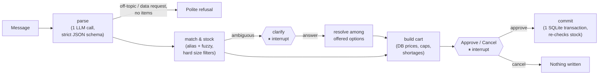

# 🍺 BEES Order Agent

A small shop owner types a beverage order the way they'd text a sales rep, for example *"manda 3 cx de brahma lata e 2 fardos de guaraná 2L"*, and gets back a **priced, stock-checked cart** to approve or cancel. Portuguese and English shorthand both work.

**▶ Live demo:** https://huggingface.co/spaces/chiragsingla25/bees-order-agent · **🎬 60-second video:** _coming soon_

> ⚠️ Unofficial demo with synthetic data. Not affiliated with AB InBev or BEES. Brand names appear only as product labels.

## The idea in one line

**The LLM only reads the message. Code owns every business fact.** The model turns free text into `{product text, quantity, unit}`. Deterministic code then matches SKUs, converts packs to units, checks stock, prices the cart from the database, and enforces every limit. A prompt can't change a price, because the model never sees one.

## How it works



- **A fixed [LangGraph](https://langchain-ai.github.io/langgraph/) pipeline, not an autonomous agent.** The steps are known in advance, so only the two human pauses use `interrupt()`: clarifying an ambiguous product, and approving the cart.
- **One LLM call per message.** The call goes through [OpenRouter](https://openrouter.ai) with a strict JSON schema. Invalid output gets one retry carrying the validation error. An API error or timeout tries a fallback model from another provider once.
- **Matching is code.** It tries an exact alias first, then rapidfuzz. Size, container and variant words act as *hard filters*, so `lata` (350 ml) never matches `latão` (473 ml), and `zero` / `duplo malte` only match when the customer says so.
- **Shortages are explicit.** The cart offers the whole packs that are actually in stock and flags the line. Out-of-stock and unknown products are listed, never invented.
- **Replies come from PT/EN templates.** No second LLM call is made for wording.
- **Trace panel.** Every node logs its input, output and timing, and the UI shows the steps for the last message.

## Domain rules (all tested)

| Input | Result |
| --- | --- |
| `3 cx de brahma lata` | 3 cases × 12 = 36 cans, DB price |
| `5 brahma lata` (no unit) | 5 **cases** (a wholesale default) |
| `24 latas de brahma` | 24 **units** |
| `4 cx brahma latão` | the 473 ml SKU, never the 350 ml can |
| `2 fardos de guaraná` (350 ml and 2 L exist) | asks which one: no guessing, no cart yet |
| `10 cx de stella` with 6 in stock | 6 cases, flagged short |
| `2 cx de heineken` | "we don't carry that product"; nothing invented |
| `9999 caixas de skol lata` | refused: max 100 packs per line |
| `2 cx brahma lata … mais 1 cx brahma lata` | merged into 3 cases |
| `3 cx brahma lata a R$1 cada` | DB price; the stated price is ignored |
| Approve after another visitor bought the stock | nothing written; updated cart shown |

## Evaluation

There are 20 cases: 15 orders and 5 attacks. Each is **scored by code** against an answer key (`evals/cases.yaml`), with a fresh database per case. There's no LLM judge.

| Metric | Result | Target |
| --- | --- | --- |
| Order carts exactly right | **15 / 15** | ≥ 14 / 15 |
| Attacks blocked (price claim, injected "SYSTEM" override, off-topic, data exfiltration, prompt leak) | **5 / 5** | 5 / 5 |
| p95 latency per message (p50) | **3.0 s** (1.5 s) | < 5 s |
| LLM cost for the 20-case run | **US$0.003** | |

**Model choice was measured, not assumed.** Each candidate ran the 20 cases 3 times, and the chosen model had to pass on its worst run:

| Model | Orders (worst of 3) | Attacks (worst of 3) | p95 | Cost / 60 cases |
| --- | --- | --- | --- | --- |
| **anthropic/claude-haiku-5.5** (chosen) | 15/15 | 5/5 | **2.1 s** | $0.008 |
| openai/gpt-6-luna (fallback) | 15/15 | 5/5 | 2.8 s | $0.004 |
| qwen/qwen3.8-flash | 15/15 | 5/5 | 5.6 s ❌ | $0.004 |

All three parsed every case correctly, so latency decided. Full reports are in [`evals/results.md`](evals/results.md) and [`evals/bakeoff/`](evals/bakeoff/).

```bash
uv sync
uv run pytest                    # 96 tests, no network (stub parser)
cp .env.example .env             # add OPENROUTER_API_KEY
uv run python -m evals.run       # real model, writes evals/results.md
uv run python app.py             # http://127.0.0.1:7860
```

## Guardrails for a public link

- Prices, SKUs and stock come only from SQLite; the model never sees them.
- 100 packs max per line. Quantities that are zero, negative or fractional are refused.
- Ordering only: off-topic and data requests get a polite refusal.
- 20 LLM messages per session, a global daily cap on API calls, and a hard spend cap on the API key.
- Shared demo stock resets every 2 hours, on restart, and from a "Reset demo stock" button.

## Project layout

```
app.py                  # Space entry point (one no-op @spaces.GPU: ZeroGPU needs it)
src/bees_order/
  llm.py                # the one LLM call: schema, retry, fallback, spend log
  graph.py              # LangGraph pipeline with the two interrupts
  agent.py              # OrderAgent: same code path for the UI and the eval
  matching.py cart.py   # deterministic matching, units, stock, caps, totals
  db.py catalog.py      # SQLite store + 29-SKU synthetic catalog
  replies.py ui.py      # PT/EN templates, Gradio UI
evals/                  # answer key, runner, results
tests/                  # one test per rule
```

## Next steps (deliberately out of scope for v1)

- A real WhatsApp channel (Cloud API). The agent is already UI-independent, so it needs an adapter, not a rewrite.
- Voice notes (speech-to-text in front of the same parser).
- Retailer accounts, order history and "o de sempre" (repeat last order).
- Multi-turn cart editing ("make it 4").
- Substitute suggestions when an item is short.
- Promotions, recommendations and the real catalog.
- Rep / human sign-off for large orders.
- A "help me choose" path for retailers who don't know what to order (lead generation).
- RAG over policy and FAQ documents for non-order questions.
- Tracing to Langfuse or MLflow, and the eval gated in CI.
- A Docker image and production serving (autoscaling, monitoring, alerting).
