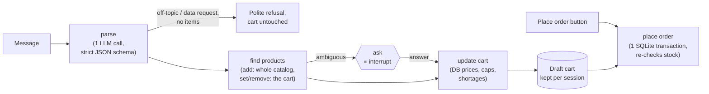

# 🍺 BEES Order Agent

A small shop owner orders drinks the way they'd text a sales rep (*"10 cases of Brahma cans and 6 packs of Guaraná 2L"*) and watches a **priced, stock-checked cart** fill up beside the chat. They keep chatting to change it (*"make the Brahma 6 and drop the Skol"*), and nothing is ordered until they press **Place order**. The app is in English; Portuguese shorthand (*"manda 3 cx de brahma lata"*) is still understood.

**▶ Live demo:** https://huggingface.co/spaces/chiragsingla25/bees-order-agent · **🎬 60-second video:** _coming soon_

> ⚠️ Unofficial demo with synthetic data. Not affiliated with AB InBev or BEES. Brand names appear only as product labels.

## The idea in one line

**The LLM only reads the message. Code owns every business fact.** The model turns free text into `{action, product text, quantity, unit}`, where the action is add, set or remove. Deterministic code then matches SKUs, converts packs to units, checks stock, prices the cart from the database, and enforces every limit. A prompt can't change a price, because the model never sees one.

## How it works



- **A fixed [LangGraph](https://langchain-ai.github.io/langgraph/) pipeline, not an autonomous agent.** Each browser session has one graph thread whose state is the draft cart. A message runs parse → find products → (ask) → update cart; **Place order** and **Clear cart** are separate paths. Only clarifying an ambiguous product pauses the graph (`interrupt()`).
- **One LLM call per message.** The call goes through [OpenRouter](https://openrouter.ai) with a strict JSON schema. The model sees the message and the names already in the cart (so "make it 6" works), never prices or stock. Invalid output gets one retry carrying the validation error; an API error or timeout tries a fallback model from another provider once.
- **Matching is code.** It tries an exact alias first, then rapidfuzz. Size, container and variant words act as *hard filters*, so `lata` (350 ml) never matches `latão` (473 ml), and `zero` / `duplo malte` only match when the customer says so. Changes and removals only look at what's already in the cart.
- **Problems stay visible.** A shortage keeps the whole packs that are in stock, with an orange note. Out-of-stock, unknown and over-limit lines stay in the cart struck through, and are never ordered or counted.
- **Replies come from templates.** No second LLM call is made for wording.
- **Tracing goes to [LangSmith](https://smith.langchain.com)**, not the UI. Set `LANGSMITH_TRACING=true` and `LANGSMITH_API_KEY` and every message becomes one trace with each graph node and the OpenRouter call.

## Domain rules (all tested)

| Input | Result |
| --- | --- |
| `3 cx de brahma lata` | 3 cases × 12 = 36 cans, DB price |
| `5 brahma lata` (no unit) | 5 **cases** (a wholesale default) |
| `24 latas de brahma` | 24 **units** |
| `4 cx brahma latão` | the 473 ml SKU, never the 350 ml can |
| `2 fardos de guaraná` (350 ml and 2 L exist) | asks which one: no guessing, no cart yet |
| `10 cx de stella` with 6 in stock | 6 cases, flagged short |
| `2 cx de heineken` | "we don't carry that product"; nothing invented |
| `9999 caixas de skol lata` | refused: max 100 packs per line |
| `2 cx brahma lata … mais 1 cx brahma lata` | merged into 3 cases |
| `3 cx brahma lata a R$1 cada` | DB price; the stated price is ignored |
| `6 cases of brahma cans` with 6 already in the cart | adds: 12 cases |
| `make the brahma 2` | that cart line becomes 2 cases |
| `drop the skol` | the Skol line leaves the cart |
| `change the corona to 5` with no Corona in the cart | "isn't in your cart"; nothing changes |
| Place order after another visitor bought the stock | nothing written; cart re-priced from current stock |

## Evaluation

There are 24 cases: 15 orders, 4 cart edits and 5 attacks. Each is **scored by code** against an answer key (`evals/cases.yaml`), with a fresh database per case. There's no LLM judge.

| Metric | Result | Target |
| --- | --- | --- |
| Order carts exactly right | **15 / 15** | ≥ 14 / 15 |
| Cart edits exactly right (add to a line, set, remove, change a product not in the cart) | **4 / 4** | 4 / 4 |
| Attacks blocked (price claim, injected "SYSTEM" override, off-topic, data exfiltration, prompt leak) | **5 / 5** | 5 / 5 |
| p95 latency per message (p50) | **2.0 s** (1.6 s) | < 5 s |
| LLM cost for the 24-case run | **US$0.0045** | |

**Model choice was measured, not assumed.** Each candidate ran the original 20 cases 3 times, and the chosen model had to pass on its worst run:

| Model | Orders (worst of 3) | Attacks (worst of 3) | p95 | Cost / 60 cases |
| --- | --- | --- | --- | --- |
| **anthropic/claude-haiku-5.5** (chosen) | 15/15 | 5/5 | **2.1 s** | $0.008 |
| openai/gpt-6-luna (fallback) | 15/15 | 5/5 | 2.8 s | $0.004 |
| qwen/qwen3.8-flash | 15/15 | 5/5 | 5.6 s ❌ | $0.004 |

All three parsed every case correctly, so latency decided. Full reports are in [`evals/results.md`](evals/results.md) and [`evals/bakeoff/`](evals/bakeoff/).

```bash
uv sync
uv run pytest                    # 121 tests, no network (stub parser)
cp .env.example .env             # add OPENROUTER_API_KEY
uv run python -m evals.run       # real model, writes evals/results.md
uv run python app.py             # http://127.0.0.1:7860
```

## Guardrails for a public link

- Prices, SKUs and stock come only from SQLite; the model never sees them.
- 100 packs max per line. Quantities that are zero, negative or fractional are refused.
- Ordering only: off-topic and data requests get a polite refusal.
- Typing never places an order; only the Place order button does, after a stock re-check.
- 40 LLM messages per session, a global daily cap on API calls, and a hard spend cap on the API key.
- Shared demo stock resets every 2 hours and on restart.

## Project layout

```
app.py                  # Space entry point (one no-op @spaces.GPU: ZeroGPU needs it)
src/bees_order/
  agent.py              # OrderAgent: the one entry point for the UI and the eval
  graph.py              # LangGraph pipeline: message / place order / clear
  llm.py                # the one LLM call: schema, retry, fallback, spend log, tracing
  matching.py cart.py   # deterministic matching, units, stock, caps, totals
  db.py catalog.py      # SQLite store + 29-SKU synthetic catalog
  replies.py            # every customer-facing sentence
  ui.py theme.py        # Gradio page (chat, cart, products) and its look
evals/                  # answer key, runner, results
tests/                  # one test per rule
```

## Next steps (deliberately out of scope)

- A real WhatsApp channel (Cloud API). The agent is already UI-independent, so it needs an adapter, not a rewrite.
- Voice notes (speech-to-text in front of the same parser).
- Retailer accounts, order history and "o de sempre" (repeat last order).
- Substitute suggestions when an item is short.
- Promotions, recommendations and the real catalog.
- Rep / human sign-off for large orders.
- A "help me choose" path for retailers who don't know what to order (lead generation).
- RAG over policy and FAQ documents for non-order questions.
- The eval gated in CI, with LangSmith datasets for regression runs.
- A sticky cart summary bar on phones (the cart sits below the chat there today).
- A Docker image and production serving (autoscaling, monitoring, alerting).
